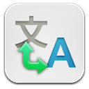
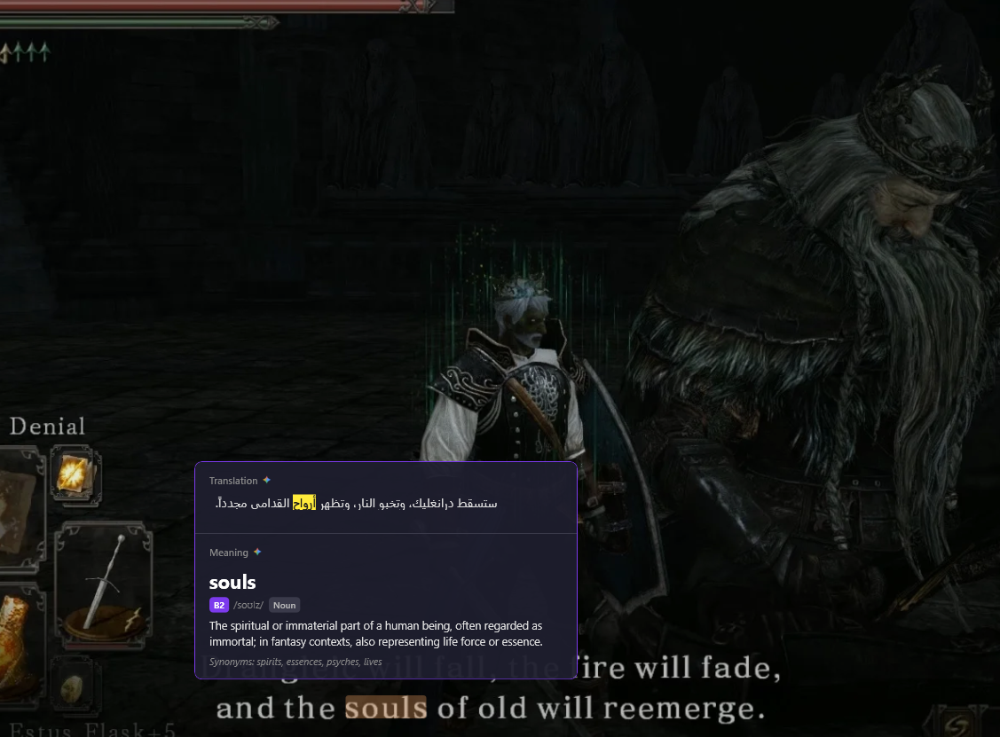

<p align="center">
  
</p>

<h1 align="center">Tarjem</h1>

<p align="center">
  <b>Screen translator overlay</b><br/>
  Hover a word, press <kbd>Alt</kbd>+<kbd>Q</kbd>, and get an instant translation.<br/>
  Drag a box with <kbd>Alt</kbd>+<kbd>W</kbd> and the text inside it is rewritten in your language, in place.<br/>
  Hit <kbd>Alt</kbd>+<kbd>E</kbd> on a name to find out what it actually is.
</p>

<p align="center">
  
  
  
  
</p>

<p align="center">
  
</p>

## How it works

Tarjem reads the word under your cursor with the OCR built into Windows, then asks the best
available source what it means and what it says in your language. It works the moment it's
installed — the default sources need no API key and no account.

**Nothing is a single point of failure.** Every lookup walks a chain of sources: the one you
chose first, then the next best. If a service is down or rate-limited, the answer quietly comes
from somewhere else instead of failing, and your setting is never rewritten behind your back.

| | Sources |
|---|---|
| **Definitions** | FreeDictionaryAPI · dictionaryapi.dev · Wiktionary · Gemini · Merriam-Webster |
| **Translation** | Google Translate · Gemini · Groq · Cerebras · Lingva · MyMemory |
| **Names** | Wikipedia · Wikidata · Gemini · Groq · Cerebras — for "NVIDIA" and other words no dictionary carries |

AI translation is *transcreation*, not word-for-word: the sentence is rewritten the way a native
speaker would have said it.

For names, the wikis come first because an answer from them is a page you can go and read. The AI
sources sit behind them for the long tail neither wiki has an entry for — a character, a small
studio, a product — and they are asked to say when they don't recognize a name rather than guess.
An answer from one of them is a recollection rather than a record, so it carries the model's name
instead of a "Read more" link.

## Shortcuts

| | |
|---|---|
| <kbd>Alt</kbd>+<kbd>Q</kbd> | Translate the word under the cursor, in the context of its sentence |
| <kbd>Alt</kbd>+<kbd>W</kbd> | Drag a box; each line inside it is redrawn in your language, where it was |
| <kbd>Alt</kbd>+<kbd>E</kbd> | "What is this?" — asks Wikipedia about the word under the cursor, and translates the answer |

All three are rebindable in Settings.

## Translating a region

<kbd>Alt</kbd>+<kbd>W</kbd> redraws each line of text where it was, on the background it sat on, in
its own text colour and at its own size. A blue button stays a blue button, a heading stays a
heading, and everything in the selection that wasn't text is left exactly as it was. The eye
button above the selection shows the original again; clicking anywhere else closes it.

**Live mode** is for dialogue and subtitles: click *Live* above the translated region and Tarjem
keeps watching it, translating each new line as it appears. The overlay lets clicks through to the
game underneath, and a small bar beside the region pauses it, shows the original, or stops it. It
only does real work when the text changes - between lines it compares a tiny thumbnail - and a
line it has already translated comes straight from the cache. Esc doesn't stop it, since games use
Esc for their menus; the bar or a new <kbd>Alt</kbd>+<kbd>W</kbd> does.

If you'd rather read the whole translation on one card - over a busy or moving game scene, say -
set **Style** to *Panel* under Settings → Overlays. Tarjem also falls back to the panel on its own
when a translator merges or splits lines, because one readable block is better than lines in the
wrong places.

## Changing language

Every result has a small language label - *EN → AR* - on the popup, the "what is this?" card and
the region overlay. Click it to pick another language to translate from or to; the answer on screen
is redone at once, and the choice becomes the default. The tray icon has the same two menus, and a
swap button flips the pair.

**Auto-detect** (the default on new installs) works the language out on every lookup: one OCR pass
per installed script finds the script, letters and common words pick the language within it, and
the translator confirms it from the whole sentence. When the translator disagrees with the guess,
it wins, and the definition is fetched again in the right language. Copied text is detected even
when a source language is set, since there's no OCR behind it - unless you pick its language on the result.

**Or don't use a shortcut at all.** Turn on *Button when you select text* and selecting anything —
in a browser, a PDF, a document — puts a small Tarjem button beside it. This is the most accurate
path in the app, because it works from the real text instead of from pixels: none of OCR's
merged-glyph or split-word failure modes apply. Off by default, since it means watching for
selections.

## Vocabulary

Every Alt+Q lookup is saved with its definition, translation, CEFR level and the sentence it came
from. Looking a word up again doesn't add a duplicate: it moves the word to the top and counts it,
so **Most looked up** on the History page shows the words you keep forgetting. You can also sort
A to Z or hardest first, and filter by level.

**Review** turns the list into practice: spaced repetition with Anki's four buttons (*Again*,
*Hard*, *Good*, *Easy* - or keys 1-4, Space to reveal), over the words you've looked up. A missed
word comes back in ten minutes, a known one at growing intervals. Open it from the History page or
the tray icon, which both show how many words are due.

**Export** writes the words on screen as an Anki deck (tab-separated, with the import directives
already set) or a CSV, so a search or a level filter doubles as "export just these".

**Pronunciation:** the speaker button beside the headword, in the popup and in History, says the
word with the speech voices built into Windows. It works offline. The button appears only when a
voice for that language is installed; you can add more in Windows Settings → Time & language →
Speech.

## When something goes wrong

Tarjem says so instead of doing nothing: a short note by the cursor when there's no text under it,
when you're offline, or when a lookup takes too long; a clear line in the popup or overlay when no
translation service answered. A service that fails or rate-limits is tried last for a while, so
one bad source doesn't slow every lookup down, and a failed answer is never cached. Each lookup
writes one line to the log - stages, timings and which source answered, never the text - so a
problem can be traced (Settings → About → Open logs folder).

Games in exclusive fullscreen can't have anything drawn over them; Tarjem notices and says so once,
with the fix (switch the game to borderless or windowed fullscreen).

## Languages

36 languages to translate into, and every one Windows can read to translate from: English, Arabic,
Spanish, French, German, Italian, Portuguese, Russian, Ukrainian, Turkish, Dutch, Polish, Czech,
Slovak, Romanian, Hungarian, Greek, Bulgarian, Croatian, Swedish, Danish, Norwegian, Finnish,
Japanese, Korean, Chinese (Simplified and Traditional), Vietnamese, Indonesian, Malay, Thai, Hindi,
Bengali, Hebrew, Persian and Urdu. Arabic, Hebrew, Persian and Urdu are laid out right to left.

Reading a language needs its Windows OCR pack (Windows Settings → Time & language → Language &
region). The pickers list the languages your PC can already read first and mark the rest.

- **Japanese** is split into real words with the Windows word breaker, so <kbd>Alt</kbd>+<kbd>Q</kbd>
  looks up 天気, not 天. Chinese gets the same once a Chinese language is installed in Windows;
  without one it falls back to single characters, still translated in the context of the sentence.
- **Hindi, Bengali, Arabic** and other scripts with combining marks keep them. Earlier versions
  stripped vowel signs before the lookup, which turned real words into different ones.

## Building

```
dotnet build Tarjem.csproj
dotnet test Tarjem.Core.Tests/Tarjem.Core.Tests.csproj
dotnet test Tarjem.UiTests/Tarjem.UiTests.csproj
```

**Testing the latest code:** run `tools\make-desktop-shortcut.ps1` once. The *Tarjem (Latest)*
shortcut it puts on the desktop closes any running copy, rebuilds the current source in Release
and starts it - so it never runs a stale Debug or installed build. Settings > About shows which
build is running and when it was compiled.

Packaging with bundled API keys: put them in a `.env` beside the built exe, run
`Tarjem.exe --pack-keys`, delete the `.env`, then build the installer.

**Tests:** `Tarjem.Core.Tests` covers the logic that has no desktop dependency (word picking, line
reflow, language detection, the in-place colour sampling); `Tarjem.UiTests` constructs every window
and drives the overlays on a real STA thread.

**Building a release:**
```
dotnet publish Tarjem.csproj -c Release -r win-x64 --self-contained false -p:DebugType=none -o bin\publish\win-x64
# pack keys into bin\publish\win-x64 as above, and make sure no .env is left there
iscc installer\TarjemSetup.iss        # -> installer\Output\TarjemSetup-<version>.exe
```
The installer checks for the .NET 8 Desktop Runtime and, if missing, downloads the latest 8.0.x
from Microsoft and installs it before copying the app.
**Never put a key in a `.cs` file.**

## Your data

Everything stays on your machine, in `%LOCALAPPDATA%\Tarjem\`:

| File | Description |
|------|-------------|
| `settings.json` | App settings — plaintext, and deliberately holds no secrets |
| `history.json` | Lookup history (can be turned off entirely) |
| `keys.dat` | Every API key, yours and the shipped ones, encrypted with Windows DPAPI |
| `logs/` | Log files (7-day rolling) |

The only thing that leaves is the word or region being translated, sent to the source you picked.


